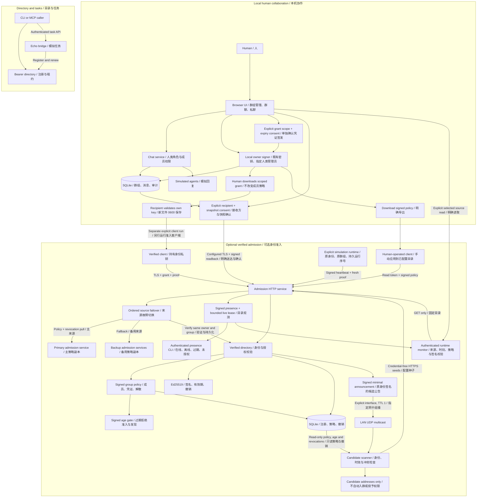
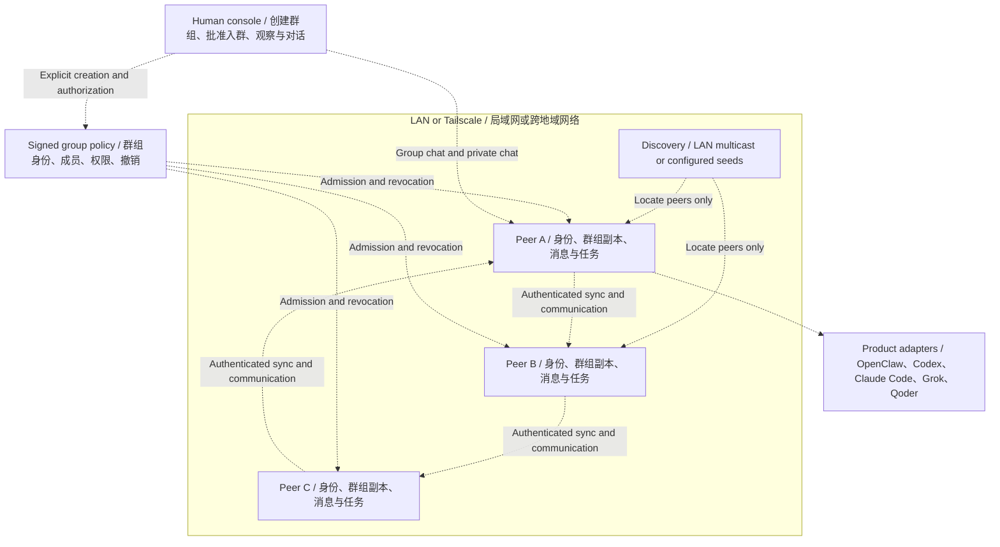

# Tailnet Agents

Build human-controlled collaboration groups for heterogeneous agents across
LANs and Tailscale networks.

**v0.24 prototype.** Working components are listed below. The network mesh and
real product adapters are not implemented. New groups require an explicit human
action; agents may only discover or restore previously authorized groups.

## Current implementation

| Component | Implemented | Boundary |
|---|---|---|
| Directory | SQLite registration, leases, ownership, removal, status | Central registry; not distributed mesh |
| Bridge | Automatic renewal, discovery CLI, authenticated Echo tasks | Custom task API; task state is in memory |
| MCP | Stdio discovery, delegation, result tools | 2025 handshake family; real client compatibility unvalidated |
| Human UI | Explicit groups, scoped chat, opt-in owner-signed creation/approval/removal/renewal/dissolution, policy export, explicit recipient delivery and human-confirmed grant issuance | Trusted loopback gateway; private-file installer; manual trusted transfer; simulated agents |
| Group lifecycle | Human membership changes, revocation, terminal dissolution, creation deduplication | Local database; no signed mesh propagation |
| Policy replication | Ordered HTTP/TLS source failover, independent revocation cursors, periodic pull and status | Configured sources only; no quorum, presence/chat/task replication |
| Candidate discovery | Signed UDP multicast with ingress filtering, HTTP/TLS seeds, sticky conflicts, synchronized policy/revocation checks | Existing directory/key required; Linux LAN receiver; candidates only, no auto-enrollment or policy-source promotion |
| Runtime monitor | Explicit authenticated reads from configured directories, signature/policy verification, attributed paginated observations and expiry | Signing admin/group creator only; receiver observations, no peer presence replication or endpoint health proof |
| Simulation runtime | Original key/group recovery, signed heartbeat leases (including 10-second TTL with fractional clocks), persisted instance ordering and authenticated presence pages | Explicit configured directory; POSIX state file; no executor or peer presence replication |
| Mesh simulator | Restart, partition reconciliation, stale claims, dissolution rules | Deterministic state model, no network or cryptographic admission |
| Signed group policy | Owner-signed snapshots, bounded signed age, approved grant IDs, rollback rejection, terminal dissolution | Opt-in verified admission; owner must renew policy, explicit UI signing/delivery and grant issuance |
| Agent identity | Ed25519 identities, signed scoped grants, expiry/revocation checks, possession proof | Verified admission integrated; human policy approval and simulation heartbeat runtime integrated; mesh/product integration pending |
| Verified directory | Proof-based registration, metadata binding, durable signed revocation | TLS service with optional durable signed member policy; human-confirmed policy delivery and signed-runtime presence; peer presence replication pending |

Different product agents will connect through adapters. Grok model API access
and Grok's product Agent are separate integration targets. No claim is made that
OpenClaw, Claude Code, Codex or Qoder already interoperate through this project.

## Architecture

### Current prototype / 当前已实现

Chat and task runtimes remain separate. The opt-in human signing gateway exports
policies for manual application or human-confirmed delivery to configured directories. Solid arrows show
implemented calls and the labeled human-operated policy handoff.



TLS is available on the admission service; its loopback mode can use HTTP.
The mesh simulator is a separate state model, not a running network service.

### Target architecture / 目标架构

Everything in this diagram is planned integration. Dashed arrows show the
intended relationships, not working end-to-end connections.



Discovery never grants membership. LAN multicast is local to a broadcast
domain; cross-region peers use configured seeds or a tailnet-aware discovery
provider. Authorized agents restore their original group after restart.
Groups sleep when all peers are offline and are dissolved only by an explicit
authorized human action. Each peer will have its own product adapter.

See [Architecture and decisions](docs/architecture.md) for the full design and
[current status](docs/status.md) for implementation limits. These Mermaid
blocks render directly in GitHub's README view.

## Start the human UI

Requires Python 3.11+. From the repository root:

```bash
export TAILNET_UI_TOKEN="$(python3 -c 'import secrets; print(secrets.token_hex(32))')"
python3 -m tailnet_agents.ui
```

Open `http://127.0.0.1:8770` on the same machine and enter that token. A fresh
installation has no group. Use "创建群组" to explicitly create one. Group chat,
named Echo replies, independent private conversations and SQLite history work.
Configure `TAILNET_UI_USERS` for separate human credentials and roles.

See [Human UI](docs/ui.md) for configuration, group management and migrations.
Do not expose this local prototype publicly or through a tailnet reverse proxy.

## Directory and bridge

```bash
export TAILNET_AGENT_TOKENS="$(python3 -c 'import json,secrets; print(json.dumps({"node-a":secrets.token_hex(32)}))')"
python3 -m tailnet_agents.registry --database state/registry.sqlite3
```

See [two-node quickstart](docs/quickstart.md) for private HTTPS origins, bridge
credentials and CLI calls. This has been tested on loopback; a real LAN/tailnet
trial is still required. Restart preserves directory ownership and invalidates
old leases until each bridge renews. Echo tasks have bounded in-memory history
and process-local idempotency; do not use them for real side effects yet.

## MCP and optional identity primitives

[MCP guide](docs/mcp.md) describes the local stdio tools. They make a client a
caller, not automatically a remotely callable worker.

```bash
python3 -m pip install -e '.[identity]'
```

The optional identity component uses `cryptography`; other services retain
standard-library runtime dependencies. [Identity guide](docs/identity.md)
describes scoped signing and admission examples, including current limits.
[Verified directory](docs/verified-directory.md) connects these checks to registration
through a trusted in-process API. [Admission HTTP](docs/admission-http.md) adds
a separate admission service and registration client. [TLS deployment](docs/tls-deployment.md)
adds certificate-verified transport for controlled cross-machine trials.
[Signed group policy](docs/group-policy.md) adds opt-in persistent membership and
dissolution checks to verified admission. A read token cannot sign a policy.
[Policy synchronization](docs/policy-sync.md) enables configured nodes to pull
signed policies and credential revocations periodically over HTTP/TLS.
Policy mode now expires active authorization 300 seconds after the signed
`issued_at` by default. Duplicate delivery, source failover and restart cannot
refresh it. The human authority must issue a newer signed revision before expiry;
an unavailable authority means admission eventually stops. Configure a stricter
persisted limit with `--policy-max-age`, and ordered independently authenticated
LAN/tailnet sources with `--policy-sources-file`. See the guide for migration,
clock requirements and the remaining partition limits.

## Locate existing peers without granting access

[Candidate discovery](docs/discovery.md) adds a separate opt-in locator layer.
Start the verified service with an existing approved simulation key and explicit
endpoint using `--discovery-agent-key` and `--discovery-endpoint`; this enables
credential-free `GET /v1/discovery`. Add `--discovery-lan-interface` only to
advertise on a selected IPv4 interface. No key or group is generated at startup.

```bash
python3 -m tailnet_agents.discovery \
  --authority-public-key state/owner.pub \
  --group-id YOUR-EXISTING-GROUP-ID \
  --directory-database state/directory-a.sqlite3 \
  --seeds-file state/discovery-seeds.json
```

Seed configuration contains URLs and optional CA paths, never tokens. LAN and
Tailscale HTTPS seeds can be mixed. Optionally listen with `--lan-interface`.
The CLI reads the existing synchronized directory database in read-only mode,
including learned revocations and its persisted policy age bound. It checks that
state again before output; optional `--policy-max-age` can only tighten the bound.
LAN receiving requires Linux and a primary local IPv4 address; ingress interface
and multicast destination are verified. Conflicts stay hidden for the entire scan.
Announcements carry only signed candidate metadata and expire within 30 seconds.
Results explicitly say `admission: not_checked`; a signature does not prove a
currently valid grant, endpoint ownership or permission to execute tasks. No
discovered endpoint is automatically contacted, registered or made a policy source.

## Human-approved signed policies (v0.20)

On the trusted human's loopback gateway, explicitly configure an existing
`--policy-owner-key`, its `--policy-owner-public-key` pin and one `--policy-admin`.
The UI can create an empty signed group, preview and approve pre-issued scoped
grants, remove identities, explicitly renew policy and sign terminal dissolution.
Startup restores the same key/group/policy without creating or renewing anything.

Download snapshots for manual application, or explicitly configure recipients
and preview/confirm delivery in the UI. Signed readback and a timestamped age
receipt verify copying; normal replication can then carry accepted policies over
LAN/Tailscale. Issuance requires a separate human confirmation; the UI does not contact discovered endpoints or register Agents. Human chat
membership and the three Echo participants remain separate from signed Agent
membership. See [human policy signing](docs/human-policy.md) for key handling,
manual delivery, retry semantics and remaining work.

## Explicit policy delivery (v0.21)

Set `--policy-targets-file` on the trusted human gateway to enable up to eight
configured origins/groups with separate read credentials from environment names.
The admin previews the exact recipient and snapshot, then explicitly confirms.
The gateway checks signatures, reads back the exact copy and records recipient
revision, age bound and check time. A historical receipt is not live membership
or execution authority. Startup, discovery, approval and previews send nothing.
See [policy delivery](docs/policy-delivery.md) for consent, retries and limitations.

## Human credential issuance (v0.22)

Preview an existing simulation Agent public key, explicit permission set and fixed
expiry, then confirm issuance separately from membership approval. Download only
after confirmation; the recipient uses `tailnet-grant-install` to verify its own
identity and save a new mode-0600 grant file without overwriting existing state.
Stable request IDs recover the same credential after a lost response or restart,
without changing expiry, policy or membership. Transfer remains a separate human
action through a trusted channel. See [credential issuance](docs/credential-issuance.md).

## Multiple Agents on one machine

One machine can host multiple independently approved Agents on LAN or Tailscale.
Each Agent keeps its own persistent private key, scoped grant and original group
reference. Membership is keyed by the Agent's public key, never its IP, hostname,
Tailscale device or display name. Give listeners distinct ports (or configure an
explicit routing gateway); sharing a host does not approve another Agent.
Removal/revocation targets the selected identity/credential, not every Agent on
the machine. Reusing one private key represents the same Agent and renews that
identity; use separate keys for separate Agents. Restart loads each original key
instead of generating replacements. These paths currently use simulated identities;
real product adapters and automatic candidate-to-runtime enrollment remain future work.

## Simulated runtime and signed presence (v0.23)

Explicitly run `tailnet-agent-runtime` with an existing Agent key, approved grant,
original group and private runtime state file. It sends signed online/offline
heartbeats with fresh possession proofs to one configured directory. Restart
preserves identity/group and advances the durable runtime generation; old instances
and replayed sequences cannot overwrite newer observations. Each Agent on the
same host uses its own key and state. `tailnet-presence` reads authenticated,
paginated observations; online means a recent authorized heartbeat. No executor
is started. See [runtime operations](docs/agent-runtime.md) for migration, expiry,
TLS, shutdown, backup and ordering limits.

## Authenticated runtime monitoring (v0.24)

In signed-group management, explicitly read one configured directory's signed
presence page. The gateway verifies owner/group/Agent signatures and source
policy agreement; the page labels its source/time and keeps same-host identities
separate. Policy mismatch cannot produce confirmed online status. Expiry ages
locally; failed reads and late responses cannot preserve old online rows. This
view neither contacts advertised Agent endpoints nor changes leases, policy or
Echo participants. Source credentials remain on the trusted gateway. See
[runtime monitoring](docs/runtime-monitoring.md) for roles, pagination and limits.

## Verification

```bash
python3 -m unittest discover -s tests -v
python3 -m tailnet_agents.mesh_sim
```

Install the identity extra to run cryptographic tests; without it, those tests
are explicitly skipped. CI runs both core and identity installations. The new signing workflow has a Chromium functional check; broader browser
visual/accessibility coverage and real-agent compatibility remain outstanding.
The dedicated CI browser job also delays policy reads and checks that download
never uses a pre-mutation snapshot; failed refreshes keep exports disabled.
v0.24 includes 296 tests: the 275-test v0.23 baseline plus 21 runtime-monitor
checks. Separate Chromium coverage verifies source selection, same-host identities,
expiry/clock rollback, read failures and stale responses after target, policy,
close and logout changes. v0.23 added 41 simulation-runtime
and signed-presence checks, including minimum ten-second TTL with fractional
clocks, transport delay and authorization expiry boundaries. Heartbeats preserve
fractional timestamps and never extend signed deadlines; remaining acknowledged
leases can be shorter than the requested TTL. Existing discovery coverage includes signed/expired/foreign records, credential isolation, conflicts,
real multicast and HTTP/TLS, ingress filtering, learned revocations, read-only
state/lease preservation, mid-scan updates, service shutdown and restart recovery.

## Design and roadmap

- [Architecture and decisions](docs/architecture.md)
- [Protocol boundaries](docs/protocol.md)
- [Registry operations and backup](docs/operations.md)
- [Current status and next work](docs/status.md)
- [Prioritized remaining work](docs/roadmap.md)

Next: replicate signed presence between peers and add explicit candidate enrollment, connect verified
identity and candidate discovery to the mesh engine, broaden browser QA,
and then add real product adapters and durable tasks.
The working registry mode remains available during mesh development.
v0.24.0 is available as a [GitHub prerelease](https://github.com/lgdu/tailnet-agents/releases/tag/v0.24.0)
with a matching annotated version tag. Release checks and tag synchronization are described
in [operations](docs/operations.md#version-and-github-tag).

No open-source license has been selected yet. Public release requires an owner
license decision. Keys, tokens and SQLite state must stay outside git.
