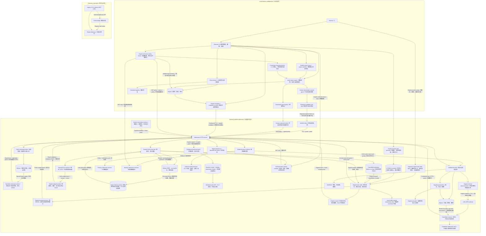
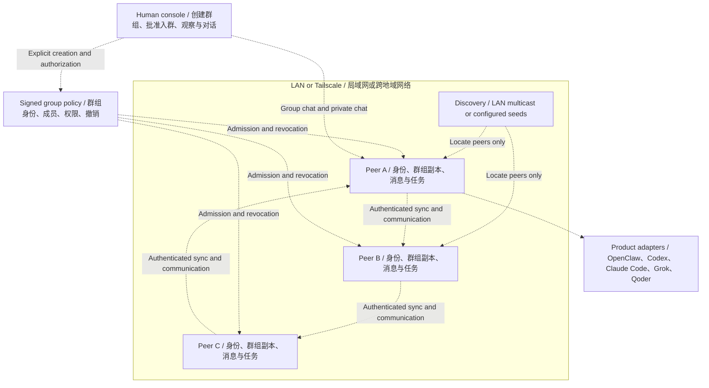

# Tailnet Agents

Build human-controlled collaboration groups for heterogeneous agents across
LANs and Tailscale networks.

**v0.33 prototype.** Working components are listed below. The network mesh and
real product adapters are not implemented. New groups require an explicit human
action; agents may only discover or restore previously authorized groups.

## Current implementation

| Component | Implemented | Boundary |
|---|---|---|
| Directory | SQLite registration, leases, ownership, removal, status | Central registry; not distributed mesh |
| Legacy bridge | Automatic renewal, discovery CLI, bearer Echo tasks | Custom v0.1 API; in-memory history; separate from durable signed tasks |
| Adapter inspection | Offline product inventory, strict Echo contract and explicit nonce-bound signed metadata probe | Synthetic Echo only; metadata compatibility grants no execution rights; no product scan, launcher or real adapter |
| Durable signed tasks | Scoped Echo tasks, durable signed intent/results, cancellation barriers/advisory notes, terminal archives/row quotas and an explicitly configured signed-task MCP caller | Simulation only; archives retain plaintext input/results; no payload deletion, running stop, verified external resolution, automatic replay, real adapters or HA |
| MCP | Separate legacy bearer tools and opt-in fixed signed-task caller; stable intent IDs, single-task submit, verified results, cancellation and archive tools | 2025 stdio tools subset; no discovery-based authority, real client/product validation, authenticated Human consent or MCP task extensions |
| Human UI | Explicit groups, scoped chat, opt-in owner-signed creation/approval/removal/renewal/dissolution, policy export, explicit recipient delivery, human-confirmed grant issuance and fixed signed-task bindings with durable preview/confirmation | Trusted loopback gateway; private-file installer; manual trusted transfer; simulated agents |
| Group lifecycle | Human membership changes, revocation, terminal dissolution, creation deduplication | Local database; no signed mesh propagation |
| Policy replication | Ordered HTTP/TLS source failover, independent revocation cursors, periodic pull and status | Configured policy sources only; no quorum, chat/task replication |
| Human policy review | Explicit all-source comparison, durable signed conflict/terminal evidence and fixed-time renewal preview/confirmation | Configured recipients only; no automatic adoption, quorum, fork repair or grant renewal |
| Candidate discovery | Signed UDP multicast with ingress filtering, HTTP/TLS seeds, sticky conflicts, synchronized policy/revocation checks | Existing directory/key required; Linux LAN receiver; candidates only, no auto-enrollment or policy-source promotion |
| Network messages | Opt-in signed group/direct text, scoped possession checks, durable sender outbox, committed receiver deduplication and paginated catch-up | One explicitly configured trusted plaintext store; simulation CLI, no E2E, Human UI bridge or automatic reply |
| Peer presence | Explicit one-hop pulls, independent grant/policy/revocation checks, attributed cache, durable observation ordering and API/CLI | Export opt-in includes scoped grants; no local leases, membership changes, multi-hop gossip or relayed UI |
| Runtime monitor | Explicit authenticated reads from configured directories, signature/policy verification, attributed paginated observations and expiry | Signing admin/group creator only; direct receiver observations; copied observations use separate API/CLI |
| Simulation runtime | Original key/group recovery, signed heartbeat leases (including 10-second TTL with fractional clocks), persisted instance ordering and authenticated presence pages | Explicit configured directory; POSIX state file; no executor; one-hop observations are separate |
| Mesh simulator | Restart, partition reconciliation, stale claims, dissolution rules | Deterministic state model, no network or cryptographic admission |
| Signed group policy | Owner-signed snapshots, bounded signed age, approved grant IDs, rollback rejection, terminal dissolution | Opt-in verified admission; owner must renew policy, explicit UI signing/delivery and grant issuance |
| Agent identity | Ed25519 identities, signed scoped grants, expiry/revocation checks, possession proof | Verified admission integrated; human policy approval and simulation heartbeat runtime integrated; mesh/product integration pending |
| Verified directory | Proof-based registration, metadata binding, durable signed revocation | TLS service with optional durable signed member policy; human-confirmed policy delivery, signed-runtime presence and separate one-hop observation cache |

Different product agents will connect through adapters. Grok model API access
and Grok's product Agent are separate integration targets. No claim is made that
OpenClaw, Claude Code, Codex or Qoder already interoperate through this project.

## Architecture

### Current prototype / 当前已实现

Human chat and signed network text remain separate; an explicit Human task bridge now uses
the signed-task caller. The opt-in human signing gateway exports
policies for manual application or human-confirmed delivery to configured directories. Solid arrows show
implemented calls and the labeled human-operated policy handoff.



TLS is available on the admission service; its loopback mode can use HTTP.
The mesh simulator is a separate state model, not a running network service.

### Target architecture / 目标架构

Everything in this diagram is planned integration. Dashed arrows show the
intended relationships, not working end-to-end connections.



Discovery never grants membership. LAN multicast is local to a broadcast
domain; cross-region peers use configured seeds or a tailnet-aware discovery
provider. Authorized agents restore their original group after restart.
Groups sleep when all peers are offline and are dissolved only by an explicit
authorized human action. Each peer will have its own product adapter.

See [Architecture and decisions](docs/architecture.md) for the full design and
[current status](docs/status.md) for implementation limits. These Mermaid
blocks render directly in GitHub's README view.

## Start the human UI

Requires Python 3.11+. From the repository root:

```bash
export TAILNET_UI_TOKEN="$(python3 -c 'import secrets; print(secrets.token_hex(32))')"
python3 -m tailnet_agents.ui
```

Open `http://127.0.0.1:8770` on the same machine and enter that token. A fresh
installation has no group. Use "创建群组" to explicitly create one. Group chat,
named Echo replies, independent private conversations and SQLite history work.
Configure `TAILNET_UI_USERS` for separate human credentials and roles.

See [Human UI](docs/ui.md) for configuration, group management and migrations.
Do not expose this local prototype publicly or through a tailnet reverse proxy.

## Directory and bridge

```bash
export TAILNET_AGENT_TOKENS="$(python3 -c 'import json,secrets; print(json.dumps({"node-a":secrets.token_hex(32)}))')"
python3 -m tailnet_agents.registry --database state/registry.sqlite3
```

See [two-node quickstart](docs/quickstart.md) for private HTTPS origins, bridge
credentials and CLI calls. This has been tested on loopback; a real LAN/tailnet
trial is still required. Restart preserves directory ownership and invalidates
old leases until each bridge renews. These legacy Echo tasks have bounded in-memory history
and process-local idempotency; do not use them for real side effects yet.

## MCP and optional identity primitives

[MCP guide](docs/mcp.md) describes the local stdio tools. They make a client a
caller, not automatically a remotely callable worker.

```bash
python3 -m pip install -e '.[identity]'
```

The optional identity component uses `cryptography`; other services retain
standard-library runtime dependencies. [Identity guide](docs/identity.md)
describes scoped signing and admission examples, including current limits.
[Verified directory](docs/verified-directory.md) connects these checks to registration
through a trusted in-process API. [Admission HTTP](docs/admission-http.md) adds
a separate admission service and registration client. [TLS deployment](docs/tls-deployment.md)
adds certificate-verified transport for controlled cross-machine trials.
[Signed group policy](docs/group-policy.md) adds opt-in persistent membership and
dissolution checks to verified admission. A read token cannot sign a policy.
[Policy synchronization](docs/policy-sync.md) enables configured nodes to pull
signed policies and credential revocations periodically over HTTP/TLS.
Policy mode now expires active authorization 300 seconds after the signed
`issued_at` by default. Duplicate delivery, source failover and restart cannot
refresh it. The human authority must issue a newer signed revision before expiry;
an unavailable authority means admission eventually stops. Configure a stricter
persisted limit with `--policy-max-age`, and ordered independently authenticated
LAN/tailnet sources with `--policy-sources-file`. See the guide for migration,
clock requirements and the remaining partition limits.

## Locate existing peers without granting access

[Candidate discovery](docs/discovery.md) adds a separate opt-in locator layer.
Start the verified service with an existing approved simulation key and explicit
endpoint using `--discovery-agent-key` and `--discovery-endpoint`; this enables
credential-free `GET /v1/discovery`. Add `--discovery-lan-interface` only to
advertise on a selected IPv4 interface. No key or group is generated at startup.

```bash
python3 -m tailnet_agents.discovery \
  --authority-public-key state/owner.pub \
  --group-id YOUR-EXISTING-GROUP-ID \
  --directory-database state/directory-a.sqlite3 \
  --seeds-file state/discovery-seeds.json
```

Seed configuration contains URLs and optional CA paths, never tokens. LAN and
Tailscale HTTPS seeds can be mixed. Optionally listen with `--lan-interface`.
The CLI reads the existing synchronized directory database in read-only mode,
including learned revocations and its persisted policy age bound. It checks that
state again before output; optional `--policy-max-age` can only tighten the bound.
LAN receiving requires Linux and a primary local IPv4 address; ingress interface
and multicast destination are verified. Conflicts stay hidden for the entire scan.
Announcements carry only signed candidate metadata and expire within 30 seconds.
Results explicitly say `admission: not_checked`; a signature does not prove a
currently valid grant, endpoint ownership or permission to execute tasks. No
discovered endpoint is automatically contacted, registered or made a policy source.

## Human-approved signed policies (v0.20)

On the trusted human's loopback gateway, explicitly configure an existing
`--policy-owner-key`, its `--policy-owner-public-key` pin and one `--policy-admin`.
The UI can create an empty signed group, preview and approve pre-issued scoped
grants, remove identities, explicitly renew policy and sign terminal dissolution.
Startup restores the same key/group/policy without creating or renewing anything.

Download snapshots for manual application, or explicitly configure recipients
and preview/confirm delivery in the UI. Signed readback and a timestamped age
receipt verify copying; normal replication can then carry accepted policies over
LAN/Tailscale. Issuance requires a separate human confirmation; the UI does not contact discovered endpoints or register Agents. Human chat
membership and the three Echo participants remain separate from signed Agent
membership. See [human policy signing](docs/human-policy.md) for key handling,
manual delivery, retry semantics and remaining work.

## Explicit policy delivery (v0.21)

Set `--policy-targets-file` on the trusted human gateway to enable up to eight
configured origins/groups with separate read credentials from environment names.
The admin previews the exact recipient and snapshot, then explicitly confirms.
The gateway checks signatures, reads back the exact copy and records recipient
revision, age bound and check time. A historical receipt is not live membership
or execution authority. Startup, discovery, approval and previews send nothing.
See [policy delivery](docs/policy-delivery.md) for consent, retries and limitations.

## Human credential issuance (v0.22)

Preview an existing simulation Agent public key, explicit permission set and fixed
expiry, then confirm issuance separately from membership approval. Download only
after confirmation; the recipient uses `tailnet-grant-install` to verify its own
identity and save a new mode-0600 grant file without overwriting existing state.
Stable request IDs recover the same credential after a lost response or restart,
without changing expiry, policy or membership. Transfer remains a separate human
action through a trusted channel. See [credential issuance](docs/credential-issuance.md).

## Multiple Agents on one machine

One machine can host multiple independently approved Agents on LAN or Tailscale.
Each Agent keeps its own persistent private key, scoped grant and original group
reference. Membership is keyed by the Agent's public key, never its IP, hostname,
Tailscale device or display name. Give listeners distinct ports (or configure an
explicit routing gateway); sharing a host does not approve another Agent.
Removal/revocation targets the selected identity/credential, not every Agent on
the machine. Reusing one private key represents the same Agent and renews that
identity; use separate keys for separate Agents. Restart loads each original key
instead of generating replacements. These paths currently use simulated identities;
real product adapters and automatic candidate-to-runtime enrollment remain future work.

## Simulated runtime and signed presence (v0.23)

Explicitly run `tailnet-agent-runtime` with an existing Agent key, approved grant,
original group and private runtime state file. It sends signed online/offline
heartbeats with fresh possession proofs to one configured directory. Restart
preserves identity/group and advances the durable runtime generation; old instances
and replayed sequences cannot overwrite newer observations. Each Agent on the
same host uses its own key and state. `tailnet-presence` reads authenticated,
paginated observations; online means a recent authorized heartbeat. No executor
is started. See [runtime operations](docs/agent-runtime.md) for migration, expiry,
TLS, shutdown, backup and ordering limits.

## Authenticated runtime monitoring (v0.24)

In signed-group management, explicitly read one configured directory's signed
presence page. The gateway verifies owner/group/Agent signatures and source
policy agreement; the page labels its source/time and keeps same-host identities
separate. Policy mismatch cannot produce confirmed online status. Expiry ages
locally; failed reads and late responses cannot preserve old online rows. This
view neither contacts advertised Agent endpoints nor changes leases, policy or
Echo participants. Source credentials remain on the trusted gateway. See
[runtime monitoring](docs/runtime-monitoring.md) for roles, pagination and limits.

## Configured peer presence replication (v0.25)

Explicitly enable `--presence-export` on a source to expose its local signed
heartbeats and scoped grants to authenticated replicas. Receivers configure
`--presence-sources-file` with fixed LAN/Tailscale origins, group, CA and credential
environment names. They independently check signatures, local policy, approved
grants and learned revocations, persisting attributed observations and ordering.
Copies cannot create members or local leases, extend deadlines, replay older
instances or relay onward. `tailnet-peer-presence` reads the merged source-scoped
view; the existing human monitor retains its direct-directory scope. See
[peer presence](docs/peer-presence.md) for opt-in disclosure, restart and limits.

## Signed network messages (v0.26)

Explicit `--messages` enables group/direct text for existing human-approved
synthetic identities at one configured admission service. `tailnet-messages`
persists signed pending messages, retries the original envelope after lost
acknowledgments and commits verified catch-up pages with durable cursors.
Every send/read requires a current scoped grant, fresh policy and possession
proof. Private history is limited to participants; the trusted store holds
plaintext, so this is not E2E encryption. Same-host clients retain separate keys
and state. No automatic group creation, replies or task execution occurs. See
[network messaging](docs/network-messages.md) for LAN/Tailscale TLS configuration,
commands, recovery and limits. Local Human UI Echo chat remains separate.

## Signed durable tasks (v0.27)

Explicit `--tasks` enables a simulated Echo executor with its original approved
Agent key/grant in the policy-enforced admission service. `tailnet-tasks` persists
original task IDs and executor selection before sending. A local paginated list
recovers IDs after terminal output loss. The executor persists
request/running/result state and signs receipts. Lost acknowledgments safely
recover the original result. After a crash, unfinished running tasks become
`uncertain` and are never automatically retried or migrated. Queued tasks need a
fresh explicit submission; reads never execute. Caller and executor both need
current `task.echo` permission. Same-host Agents/executors retain independent
keys and private state. See [durable tasks](docs/durable-tasks.md) for commands,
TLS, recovery and bounds. Legacy bearer bridge/MCP tasks remain separate.

## All-source policy review and human renewal (v0.28)

In signed-group management, **核对所有配置来源** reads every configured recipient,
including backups hidden by healthy-primary failover. The panel compares signed
revisions, semantic conflicts and each directory's age bound. It retains verified
higher revisions, equivocation and terminal evidence across source failure/removal
and gateway restart; known unsafe history blocks new policy signatures.
**预览人工续期（先核对来源）** prepares a fixed timestamp and 60-second confirmation
window. A separate confirmation signs only the original group's next revision,
with unchanged members and credential IDs; it never renews grants or delivers
policy. A failed source cannot prove history complete. No snapshot is automatically
chosen or adopted, and discovery cannot add sources. See [policy review](docs/policy-review.md)
for incomplete reads, persistent evidence, retry semantics and recovery limits.

## Reference adapter contract and probing (v0.29)

`tailnet-adapters catalog` lists implemented versus unimplemented adapters offline,
without scanning or starting installed products. OpenClaw, Codex, Claude Code,
Qoder and Grok Agent remain unimplemented; Grok model API is a separate target.
`tailnet-adapters probe` explicitly reads nonce-bound signed metadata from one
configured `--tasks` Echo executor using its original public pin, owner/group,
audience and read credential. It validates the strict Echo contract and a lifetime
of at most 15 seconds, bounded by receiver policy/grant expiry. Same-host executors
keep separate key identities. Probe requests never submit/recover tasks, register
members or issue credentials. `compatible_metadata` is a historical observation,
not execution authorization or a product health check. See [adapter contracts](docs/adapters.md)
for commands, supported metadata, task permission boundaries and future product work.

## Explicit task cancellation and uncertainty records (v0.30)

Use local `cancel-preview` and separately confirmed `cancel` on the original task
ID/hash. The caller persists cancellation intent before I/O and excludes that task
from `flush`, even after failed cancellation, refresh or restart. The executor can
cancel an absent/unstarted intent with a signed durable tombstone; late original
submissions return that receipt without running. Running/completed/failed/uncertain
work cannot be relabeled stopped. Caller `review-preview`, `review` and `reviews`
append signed, local advisory notes bound to an original uncertain receipt; they
never change its result or authorize retry. Existing identity/group/source pins
and fresh scoped network proofs remain required. See [task operations](docs/task-operations.md)
for explicit confirmation, pending-cancel semantics, CLI commands and the one-way
caller-state migration that prevents older clients ignoring cancellation intent.

## Explicit task archives and quotas (v0.31)

Use local `archive-preview` and a separate `archive` confirming the original ID,
request hash and terminal receipt hash. Only completed/failed/cancelled records
move to the same executor database's archive; all signed input/result history is
retained. Existing reads and late submissions return the original receipt without
execution. Active slots are freed, while global and per-caller history counts stay
unchanged. Four explicit service limits bound active/total rows globally and by
caller public key, including multiple Agents on one host. Uncertain work remains
in the active area. This does not delete plaintext or reduce disk use. See
[task archives and quotas](docs/task-history.md) for commands, defaults and the
one-way executor migration that makes older executors refuse the new state.

## Human-confirmed signed tasks (v0.33)

The loopback UI can explicitly bind up to sixteen original signed Echo callers
using private configuration. Only the configured admin who created the signed
group may operate its bindings. Each queue/submit/refresh/cancel/archive action
has a separate exact-input/task preview and 60-second server-bound confirmation;
a durable authorization precedes mutation/network I/O. Lost acknowledgments and
restart recover the same consent/task, without automatic dispatch or another ID.
Local task/consent history stays separate from simulated chat and MCP tools.

No discovery grants authority. Original keys/groups and same-host Agent separation
remain intact. The separate UI bearer credential authenticates the configured
human on this trusted local gateway; no external Human authentication, Human
signature or consent requirement on direct CLI/MCP use is claimed. Remote task
operations still enforce the original scoped authorization and signed receipts.
See [Human task UI](docs/task-ui.md) for setup, recovery and remaining limits.

v0.33 includes 571 tests, adding 24 Human task-UI checks (two core, 22 identity)
and a fourth Chromium workflow. It is published as a GitHub prerelease with
a matching annotated version tag; see the release link below.

## Explicit signed-task MCP caller (v0.32)

`tailnet-tasks-mcp` uses a private fixed configuration and the original signed
caller state. A stable caller-supplied task ID makes local queue retries recover
the exact original intent after lost responses/restart. Preview and separately
confirmed submit affect only that task, preserving cancellation barriers and
uncertainty; running/terminal receipts return locally without another submission.
Separate tools read local/downloaded results, explicitly refresh, cancel and
archive. No tool can change URL/keys/state/executor or create membership. Confirmation
arguments are caller assertions, not independently authenticated Human consent.
The old bearer MCP remains independent. See [signed-task MCP](docs/task-mcp.md)
for twelve tools, private configuration, protocol limits and recovery.

## Verification

```bash
python3 -m unittest discover -s tests -v
python3 -m tailnet_agents.mesh_sim
```

Install the identity extra to run cryptographic tests; without it, those tests
are explicitly skipped. CI runs both core and identity installations. The new signing workflow has a Chromium functional check; broader browser
visual/accessibility coverage and real-agent compatibility remain outstanding.
The dedicated CI browser job also delays policy reads and checks that download
never uses a pre-mutation snapshot; failed refreshes keep exports disabled.
v0.32 includes 547 tests: 31 new signed-MCP checks (six core, 25 identity) plus the
516-test v0.31 baseline. New cases exercise actual stdio processes, fixed private
configuration, stable IDs, lost-response/commit recovery, single-task submission,
cancel barriers, archived results, same-host callers, HTTP/TLS and sanitized errors.
v0.31 added 33 archive/quota checks to the 483-test v0.30 baseline.
New checks cover full-record atomic moves, all four quotas, same-host callers and
executors, late retries, cancellation tombstones, failures, HTTP/TLS and real CLIs.
v0.30 added 30 task-operation checks to the 453-test v0.29
baseline. New cases cover cancellation/starting races, lost ACKs, transactional
faults, durable caller barriers, same-host isolation and advisory review integrity.
v0.29 added 30 contract/probe checks. Five new checks run without the identity extra; 25 exercise signed
metadata, HTTP/TLS, the CLI, expiry, context/replay failures and same-host recovery.
v0.28 added 33 policy-review checks for all-source HTTP/TLS reads, durable conflicts/terminal evidence, partial
failures, transaction rollback, fixed-time consent and concurrency/retry guards.
A third Chromium check covers the review/renewal panel and stale responses.
A fourth (`scripts/check_task_ui.py`) covers separate Human task confirmation,
original-ID recovery, cancellation/archive, expired/edited previews and stale views.
v0.27 added 35 durable-task
checks, including a real process crash after a simulated side effect, conservative
uncertainty, transaction failures, signed receipt checks and independent same-host
executors/callers. v0.26 added 33 network-message checks covering actual HTTP/TLS and service/client processes, participant isolation,
current authorization, same-host identities, lost-ACK deduplication, offline/restart
recovery and atomic catch-up cursors. v0.24 added 21 runtime-monitor checks. Separate Chromium coverage verifies source selection, same-host identities,
expiry/clock rollback, read failures and stale responses after target, policy,
close and logout changes. v0.23 added 41 simulation-runtime
and signed-presence checks, including minimum ten-second TTL with fractional
clocks, transport delay and authorization expiry boundaries. Heartbeats preserve
fractional timestamps and never extend signed deadlines; remaining acknowledged
leases can be shorter than the requested TTL. Existing discovery coverage includes signed/expired/foreign records, credential isolation, conflicts,
real multicast and HTTP/TLS, ingress filtering, learned revocations, read-only
state/lease preservation, mid-scan updates, service shutdown and restart recovery.

## Design and roadmap

- [Architecture and decisions](docs/architecture.md)
- [Protocol boundaries](docs/protocol.md)
- [Registry operations and backup](docs/operations.md)
- [Current status and next work](docs/status.md)
- [Human-confirmed signed task UI](docs/task-ui.md)
- [Prioritized remaining work](docs/roadmap.md)

Next: validate actual product interfaces when available, implement explicitly
scoped real adapters, and conduct physical deployment trials. Quorum/automatic policy reconciliation, safe fork
resolution and explicit candidate enrollment remain open; connect verified identity
and candidate discovery to the mesh engine and broaden browser QA.
The working registry mode remains available during mesh development.
v0.33.0 is available as a [GitHub prerelease](https://github.com/lgdu/tailnet-agents/releases/tag/v0.33.0)
with a matching annotated version tag. Release checks and tag synchronization are described
in [operations](docs/operations.md#version-and-github-tag).

No open-source license has been selected yet. Public release requires an owner
license decision. Keys, tokens and SQLite state must stay outside git.
