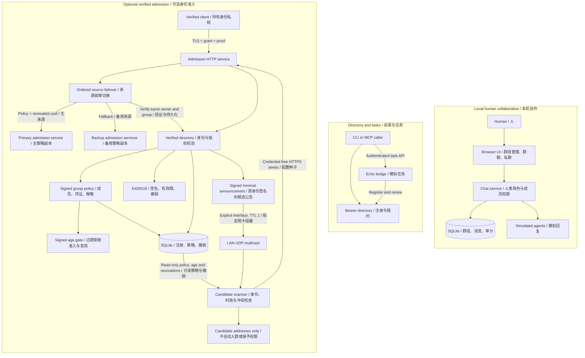
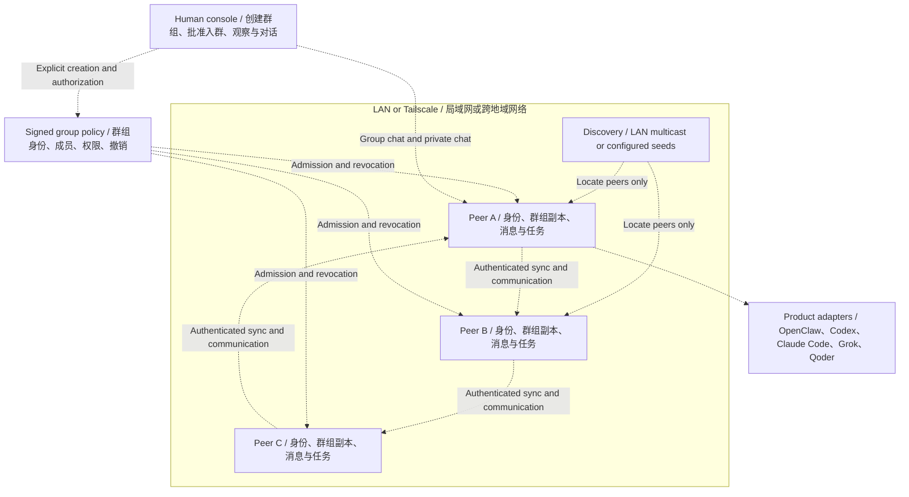

# Tailnet Agents

Build human-controlled collaboration groups for heterogeneous agents across
LANs and Tailscale networks.

**v0.19 prototype.** Working components are listed below. The network mesh and
real product adapters are not implemented. New groups require an explicit human
action; agents may only discover or restore previously authorized groups.

## Current implementation

| Component | Implemented | Boundary |
|---|---|---|
| Directory | SQLite registration, leases, ownership, removal, status | Central registry; not distributed mesh |
| Bridge | Automatic renewal, discovery CLI, authenticated Echo tasks | Custom task API; task state is in memory |
| MCP | Stdio discovery, delegation, result tools | 2025 handshake family; real client compatibility unvalidated |
| Human UI | Explicit groups, human roles, scoped group/private chat, polling, pagination | Loopback-only, simulated agents, no E2E encryption |
| Group lifecycle | Human membership changes, revocation, terminal dissolution, creation deduplication | Local database; no signed mesh propagation |
| Policy replication | Ordered HTTP/TLS source failover, independent revocation cursors, periodic pull and status | Configured sources only; no quorum, presence/chat/task replication |
| Candidate discovery | Signed UDP multicast with ingress filtering, HTTP/TLS seeds, sticky conflicts, synchronized policy/revocation checks | Existing directory/key required; Linux LAN receiver; candidates only, no auto-enrollment or policy-source promotion |
| Mesh simulator | Restart, partition reconciliation, stale claims, dissolution rules | Deterministic state model, no network or cryptographic admission |
| Signed group policy | Owner-signed snapshots, bounded signed age, approved grant IDs, rollback rejection, terminal dissolution | Opt-in verified admission; owner must renew policy, no UI issuance or automatic enrollment |
| Agent identity | Ed25519 identities, signed scoped grants, expiry/revocation checks, possession proof | Verified admission integrated; no UI/mesh identity integration |
| Verified directory | Proof-based registration, metadata binding, durable signed revocation | TLS service with optional durable signed member policy; not mesh/UI integrated |

Different product agents will connect through adapters. Grok model API access
and Grok's product Agent are separate integration targets. No claim is made that
OpenClaw, Claude Code, Codex or Qoder already interoperate through this project.

## Architecture

### Current prototype / 当前已实现

These are three independent paths. The human UI does not yet issue signed
grants or connect to either directory. Solid arrows show implemented calls.



TLS is available on the admission service; its loopback mode can use HTTP.
The mesh simulator is a separate state model, not a running network service.

### Target architecture / 目标架构

Everything in this diagram is planned integration. Dashed arrows show the
intended relationships, not working end-to-end connections.



Discovery never grants membership. LAN multicast is local to a broadcast
domain; cross-region peers use configured seeds or a tailnet-aware discovery
provider. Authorized agents restore their original group after restart.
Groups sleep when all peers are offline and are dissolved only by an explicit
authorized human action. Each peer will have its own product adapter.

See [Architecture and decisions](docs/architecture.md) for the full design and
[current status](docs/status.md) for implementation limits. These Mermaid
blocks render directly in GitHub's README view.

## Start the human UI

Requires Python 3.11+. From the repository root:

```bash
export TAILNET_UI_TOKEN="$(python3 -c 'import secrets; print(secrets.token_hex(32))')"
python3 -m tailnet_agents.ui
```

Open `http://127.0.0.1:8770` on the same machine and enter that token. A fresh
installation has no group. Use "创建群组" to explicitly create one. Group chat,
named Echo replies, independent private conversations and SQLite history work.
Configure `TAILNET_UI_USERS` for separate human credentials and roles.

See [Human UI](docs/ui.md) for configuration, group management and migrations.
Do not expose this local prototype publicly or through a tailnet reverse proxy.

## Directory and bridge

```bash
export TAILNET_AGENT_TOKENS="$(python3 -c 'import json,secrets; print(json.dumps({"node-a":secrets.token_hex(32)}))')"
python3 -m tailnet_agents.registry --database state/registry.sqlite3
```

See [two-node quickstart](docs/quickstart.md) for private HTTPS origins, bridge
credentials and CLI calls. This has been tested on loopback; a real LAN/tailnet
trial is still required. Restart preserves directory ownership and invalidates
old leases until each bridge renews. Echo tasks have bounded in-memory history
and process-local idempotency; do not use them for real side effects yet.

## MCP and optional identity primitives

[MCP guide](docs/mcp.md) describes the local stdio tools. They make a client a
caller, not automatically a remotely callable worker.

```bash
python3 -m pip install -e '.[identity]'
```

The optional identity component uses `cryptography`; other services retain
standard-library runtime dependencies. [Identity guide](docs/identity.md)
describes scoped signing and admission examples, including current limits.
[Verified directory](docs/verified-directory.md) connects these checks to registration
through a trusted in-process API. [Admission HTTP](docs/admission-http.md) adds
a separate admission service and registration client. [TLS deployment](docs/tls-deployment.md)
adds certificate-verified transport for controlled cross-machine trials.
[Signed group policy](docs/group-policy.md) adds opt-in persistent membership and
dissolution checks to verified admission. A read token cannot sign a policy.
[Policy synchronization](docs/policy-sync.md) enables configured nodes to pull
signed policies and credential revocations periodically over HTTP/TLS.
Policy mode now expires active authorization 300 seconds after the signed
`issued_at` by default. Duplicate delivery, source failover and restart cannot
refresh it. The human authority must issue a newer signed revision before expiry;
an unavailable authority means admission eventually stops. Configure a stricter
persisted limit with `--policy-max-age`, and ordered independently authenticated
LAN/tailnet sources with `--policy-sources-file`. See the guide for migration,
clock requirements and the remaining partition limits.

## Locate existing peers without granting access

[Candidate discovery](docs/discovery.md) adds a separate opt-in locator layer.
Start the verified service with an existing approved simulation key and explicit
endpoint using `--discovery-agent-key` and `--discovery-endpoint`; this enables
credential-free `GET /v1/discovery`. Add `--discovery-lan-interface` only to
advertise on a selected IPv4 interface. No key or group is generated at startup.

```bash
python3 -m tailnet_agents.discovery \
  --authority-public-key state/owner.pub \
  --group-id YOUR-EXISTING-GROUP-ID \
  --directory-database state/directory-a.sqlite3 \
  --seeds-file state/discovery-seeds.json
```

Seed configuration contains URLs and optional CA paths, never tokens. LAN and
Tailscale HTTPS seeds can be mixed. Optionally listen with `--lan-interface`.
The CLI reads the existing synchronized directory database in read-only mode,
including learned revocations and its persisted policy age bound. It checks that
state again before output; optional `--policy-max-age` can only tighten the bound.
LAN receiving requires Linux and a primary local IPv4 address; ingress interface
and multicast destination are verified. Conflicts stay hidden for the entire scan.
Announcements carry only signed candidate metadata and expire within 30 seconds.
Results explicitly say `admission: not_checked`; a signature does not prove a
currently valid grant, endpoint ownership or permission to execute tasks. No
discovered endpoint is automatically contacted, registered or made a policy source.

## Verification

```bash
python3 -m unittest discover -s tests -v
python3 -m tailnet_agents.mesh_sim
```

Install the identity extra to run cryptographic tests; without it, those tests
are explicitly skipped. CI runs both core and identity installations. Browser
visual/interaction validation and real-agent compatibility remain outstanding.
v0.19 includes 155 tests: the 117-test v0.18 baseline plus 38 candidate-discovery
checks covering signed/expired/foreign records, credential isolation, conflicts,
real multicast and HTTP/TLS, ingress filtering, learned revocations, read-only
state/lease preservation, mid-scan updates, service shutdown and restart recovery.

## Design and roadmap

- [Architecture and decisions](docs/architecture.md)
- [Protocol boundaries](docs/protocol.md)
- [Registry operations and backup](docs/operations.md)
- [Current status and next work](docs/status.md)
- [Prioritized remaining work](docs/roadmap.md)

Next: connect human group creation to signed policies and explicit enrollment,
add signed presence propagation, connect verified
identity and candidate discovery to the mesh engine, validate the
human UI in a browser, and then add real product adapters and durable tasks.
The working registry mode remains available during mesh development.
v0.19.0 is available as a [GitHub prerelease](https://github.com/lgdu/tailnet-agents/releases/tag/v0.19.0)
with a matching version tag. Release checks and tag synchronization are described
in [operations](docs/operations.md#version-and-github-tag).

No open-source license has been selected yet. Public release requires an owner
license decision. Keys, tokens and SQLite state must stay outside git.
