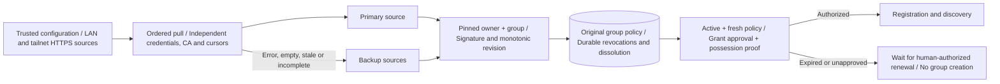
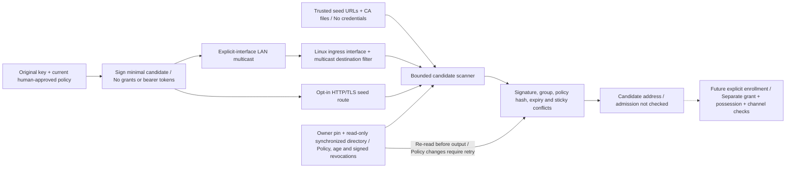

# ADR 001: Authorized, self-organizing agent groups

Status: accepted direction; implementation staged. This document supersedes
"destroy the group when its last online member disappears". Existing registry
mode remains usable. Mesh mode is not implemented on the network yet.

The [README architecture diagrams](../README.md#architecture) show the current
independent implementation paths and the planned integrated peer network.
Solid arrows describe implemented calls; dashed arrows describe future
integration. Discovery, authorization and product adapters remain distinct.

## Product contract

A human owns a trust domain and explicitly creates each logical group.
Authorized agents discover and resume those groups across LAN,
Tailscale, or configured seed links. Machines need not belong to Tailscale on a
LAN. Discovery grants no membership or execution authority. Agent products are
executors behind bridges, not trusted permission engines.

A group survives member downtime and restart. An empty online set means sleep,
not destruction. Membership credentials, identity and conversation history are
persistent; presence is temporary. Explicit authorized dissolution permanently
closes that group instance. A new instance has a new ID, even with the same name.

## Identities and durable data

| Object | Stable identity | Persistence |
|---|---|---|
| Trust domain | Owner public key / domain ID | Human-controlled trust configuration |
| Group instance | Random unique group ID bound to signed policy | Member nodes and approved storage |
| Agent | Independent public key / agent ID | Local private key, grants and group references |
| Human | Independent authenticated user principal | Trusted UI account/session provider |
| Runtime incarnation | Fresh boot identifier | Presence and diagnostics only |
| Message/task | Unique ID and origin | Relevant authorized storage/executor |

Human principals and agents are distinct. A restarted process retains the agent
identity and group instance, but starts a fresh runtime incarnation. IP addresses,
DNS names and display names are locators, not identity. Private keys never gossip.

## Components

1. Discovery providers: opt-in IPv4 multicast and explicit HTTP/TLS seeds produce
   signed candidates. mDNS/DNS-SD, tailnet enumeration and mesh enrollment remain planned.
2. Group engine: verified membership claims, anti-entropy synchronization,
   local reachability observations, persistent checkpoints.
3. Authorization verifier: signed policies and scoped credentials, proof of
   private-key possession, expiry and revocation checks.
4. Task adapter: authenticated peer calls, durable idempotency and results.
5. Human gateway: trusted Web UI, human sessions, chat routing and approvals.
6. Conversation store: initially one designated node per group.

Discovery announcements contain protocol version, group ID, policy fingerprint
and an entry endpoint; do not expose detailed capabilities or private history
before authentication. Candidate addresses must be validated independently and
must never receive credentials before verified identity/channel setup.

LAN discovery is limited to interfaces selected by the user; guest Wi-Fi
isolation and blocked multicast require seeds. Tailnet probing uses only visible,
allowed candidate devices, with bounded concurrency and explicit ports. Merge
candidates from providers by verified identity, not address.

## Group state transitions

| Trigger | Result |
|---|---|
| Authorized member finds an existing group | Verify identity, policy and grant; synchronize |
| Authorized member has saved group but finds no peer | Resume same group provisionally; keep searching |
| Agent has no saved or authorized group | Remain unbound; show a join/create request to a human |
| Authorized human confirms creation | Create a new signed group instance and issue scoped invitations |
| Member disconnects | Locally mark unreachable; preserve member qualification |
| Member restarts | Restore identity/group; authenticate; synchronize; announce fresh incarnation |
| Member explicitly leaves | Publish signed leave with monotonically newer member revision |
| Owner authorizes rejoin after leave | Issue admission according to current policy |
| All members become unreachable | No active runtime, persistent group remains recoverable |
| Administrator dissolves | Publish durable signed terminal record; never revive this group ID |

Two disconnected replicas of the SAME group reconcile later. Different group
IDs do not automatically merge. If two humans independently confirm creation of two groups,
the UI displays both; an authorized human chooses consolidation in a later phase.
A network timeout never proves that a group does not exist.

## Replication and conflict rules

Replicate verified member claims, group policy and signed terminal records.
A member authors its own join/heartbeat/leave claims. Other members can report
reachability observations but cannot impersonate the subject or revoke it.
Higher valid revisions supersede lower revisions; contradictory claims at an
equal revision are equivocation and require explicit handling, not last-arrival
wins. Persist revision counters across restart. Detect cloned identity instances;
production fencing/credential rotation is required before accepting conflicting
writers. A group-level terminal dissolution record dominates membership updates.

The simulator models these ordering rules after verification. Production needs
standard cryptographic encoding, domain separation, policy/credential validation,
replay bounds and an admission check. A Python caller-supplied sender string is
NOT authentication. Gossip/SWIM alone is NOT the permission layer.

## Authorization and revocation

Preconfigure the owner's public key. Credentials bind domain, group scope,
subject key, role, allowed skills, expiry and issuer. Default members cannot
issue grants. New-group creation belongs to authorized HUMAN principals, not agent runtime
policy. Membership and recovery permissions are separate from creation.
Each task is authorized by the receiving bridge regardless of model output.

During partition, immediate global revocation is unavailable. Ordinary grants
have bounded validity; sensitive actions require sufficiently fresh authorization
confirmation and fail closed when unavailable. Revocation and dissolution must
remain durable longer than stale credentials can be accepted. Offline nodes may
not yet know dissolution; sensitive work cannot rely only on their stale copy.
Authority key recovery/rotation and credential renewal UX remain open decisions.

### Implemented signed-age gate and configured-source failover (v0.18)

In verified policy mode, active authorization ends at signed `issued_at` plus a
local maximum age (default 300 seconds). The bound persists in SQLite and cannot
be increased by restarting; it can be tightened. Receiving the same snapshot,
restarting or changing sources never changes that deadline. Registration leases
are capped by both policy and credential expiry. Registration/discovery fail
closed on stale policies or policy timestamps more than 30 seconds in the future.
Trusted synchronized wall clocks are required; this is not a secure-clock design.

Only the existing human-controlled authority can sign a newer policy revision.
Receivers and source relays possess no owner private key and cannot automatically
refresh authorization. Missing sources or expired policy preserve the original
group, identity and tombstones while waiting; they never create a replacement.

Every poll starts with the primary and stops after the first source supplies a
usable policy and a completed bounded revocation scan. A source's cursor cannot
skip another source's records. Valid partial records persist through failover.
Existing owner/group pins, rollback/conflict rejection and terminal dissolution
apply equally to all sources. Status reports source indexes, not credentials or
transport exception contents. No credentials are obtained from peer discovery.

Ordered failover is not quorum consensus, anti-entropy across all sources or
replay-resistant online authority attestation. A still-fresh primary may hide a
newer backup policy; unseen revocations remain possible within the age bound.
LAN and Tailscale use the same hostname-verified TLS transport. Cross-machine
trials and integrated mesh discovery remain future work; tests use synthetic identities.

### Implemented candidate discovery (v0.19, unreleased)

An existing approved simulation key signs short-lived minimal announcements.
The verified directory's optional public seed route and opt-in multicast publisher
use its current policy, persisted age bound and learned revocations. Missing,
expired, dissolved or unapproved state suppresses publication; startup never
creates a group/key or loads the owner private key. UDP is unsolicited, one
packet per five seconds on one selected IPv4 interface, multicast TTL 1.

The scanner contacts only configured seed origins, sends no Authorization/Cookie
headers and never follows candidate URLs or redirects. HTTPS chain/hostname trust
is independent of the announcement signature. Provider results merge by verified
subject, not locator. Any second distinct locator marks that key as conflicted
for the entire scan, including after expiry or dropping a third locator. Provider
labels belong only to the retained announcement version. Duplicate delivery
cannot refresh signed expiry. Announcements are
at most 30 seconds old; more than five seconds of future issue time is rejected.

A local-policy candidate is not proof of an unexpired grant, live endpoint/channel
ownership or execution rights. The CLI requires an existing synchronized directory
database and reads it without opening Registry or resetting leases. It enforces
the owner/group pin, policy mode, persisted age bound and signed learned revocations,
then re-reads state before output. Newly learned revocations/tighter bounds apply;
a changed policy aborts the scan for retry. Later updates require another scan.
LAN reception fails closed without Linux IP_PKTINFO and a local primary IPv4
address. Ingress interface/destination checks precede the 128-attempts/second
verification limit; that limit pauses processing without ending the scan early.
Same-interface flooding can still exhaust receive queues. No discovery result automatically
changes membership, invokes registration, learns owner trust or becomes a policy
source. The signed policy/grant/proof path remains mandatory for admission.
Cloned-key fencing, mDNS, tailnet enumeration, actual cross-machine trials and
the integrated group runtime remain future work. See [discovery](discovery.md).

## Human interaction

The human UI shows groups, verified members, local reachability, capabilities,
tasks and pending approvals. Do not display inferred reachability as global fact.
Initially use one trusted human gateway; accepting an arbitrary member's Web UI
as an administrator entry is not safe. Later alternate entry points need explicit
trust registration and signed human authorization semantics.

Group chat supports explicit mentions. Ordinary messages go to a designated
moderator agent, not every agent. Agent messages do not trigger automatic peer
replies by default. Explicit discussion rounds bound participants and depth.
Messages include conversation ID, message ID, sender principal, reply reference,
message kind and provenance. Chat, task submission and approval are distinct.

Private chat ACLs include only the human and target agent. Initial trusted
storage can enforce those ACLs; confidentiality from storage or relay operators
requires end-to-end encryption before making that promise. Do not advertise E2E
privacy based only on UI filtering. No group administrator implicit read access.

Conversation history uses a designated store initially. Its downtime does not
stop discovery or peer tasks, but history/delivery can be unavailable. A UI outbox
holds unsent messages and shows pending status. No false "delivered" acknowledgment.
Group dissolution does not imply irreversible deletion of history; retention is
an explicit separate human action.

## Tasks

The caller chooses an executor. Deduplication lives on that executor and must
be durable before real side effects. Do not automatically migrate an uncertain
task to another executor. Model permissions and network permissions are both
necessary; network membership never grants filesystem or secret access.

## Implementation stages

- v0.4: central directory, Echo bridges and MCP tools (existing).
- v0.5: design contract and deterministic mesh state simulator.
- v0.6–v0.10: local human UI, roles, explicit groups and lifecycle.
- v0.11: optional Agent signature/grant primitives, not integrated with mesh.
- v0.12: in-process verified directory admission and durable signed revocation;
  existing network services remain unchanged.
- v0.13: separate loopback HTTP admission and signed registration client;
  no cross-machine mesh or UI policy integration.
- v0.14: direct TLS admission transport with client CA/hostname validation;
  real LAN/tailnet trials and signed group-policy integration remain pending.
- v0.15: durable signed group policy, explicitly approved credential IDs,
  rollback/conflict rejection and terminal dissolution in opt-in verified admission.
- v0.16: configured-peer full signed-policy pull over HTTP/TLS, periodic
  synchronization, manual CLI and read-protected status. No automatic mesh discovery.
- v0.17: paginated signed credential-revocation replication, bounded scans,
  restart-safe learned revocations and source generation handling.
- v0.18: signed-age authorization gate, persisted tighter bounds,
  lease expiry caps and ordered configured-source failover with separate cursors.
- v0.19 (unreleased): existing-identity candidate beacons over explicit-interface
  multicast and configured HTTP/TLS seeds; no automatic enrollment.
- Next: human UI signing/renewal workflow and explicit candidate enrollment.
- Next: mesh transport with cryptographic admission and signed presence.
- Then: validated agent adapters, durable tasks and real LAN/tailnet trials.

Do not replace working registry mode until mesh fault and authorization tests pass.

## Acceptance scenarios

Restart retains identity and original group. Creator departure does not dissolve.
Partition recovery converges membership without granting extra permissions.
Foreign-domain/group claims and unauthorized admission are rejected. Stale leave
or join messages cannot roll state back. All-node downtime is recoverable from
saved state. Authorized dissolution is terminal once learned. Chat does not loop;
private history is isolated; uncertain tasks are not silently executed twice.

## ADR amendment: human-confirmed group creation

New logical groups MUST be created by a human action with a concrete name,
new unique ID, trust policy, selected initial members and history policy.
Agent runtime cannot silently invent a group ID, clone a group from a display
name, or expand membership when discovery times out. An agent can suggest
creation/join and display candidates; an authorized human makes the decision.

Previously authorized agents may automatically rejoin or resume a saved group
instance, using the SAME group ID and still-valid qualification. That is recovery,
not new creation. Show "restoring original group" or "waiting for peers" in the
human interface. No timeout may turn restoration into new-group creation.
If credential renewal, policy freshness or dissolution status cannot be established,
apply the authorization rules above; do not silently bypass them.

The current chat demo requires human creation for fresh groups; existing legacy
group history is preserved on upgrade. The simulator receives its policy from
the test harness. Neither currently creates dynamic
network groups. v0.9 implements a local human group-creation form and database membership checks.
Its human UI signing flow and mesh propagation remain to be implemented. The old automatic-creation proposal is superseded.

Current implementation boundaries are tracked in [status.md](status.md); signed group
policy issuance from the human UI and full lifecycle replication remain future work.
v0.15 implements durable owner-signed group snapshots and opt-in enforcement
in verified admission, including member removal and terminal dissolution.
v0.16 adds configured-peer policy replication, including removals and dissolution.
v0.17 also replicates signed credential revocations. Presence, chat and tasks
are not replicated.
The human UI and mesh simulator remain separate from these snapshots.
v0.18 bounds active-policy age and adds source failover; it does not connect those
independent paths or grant membership through discovery.
