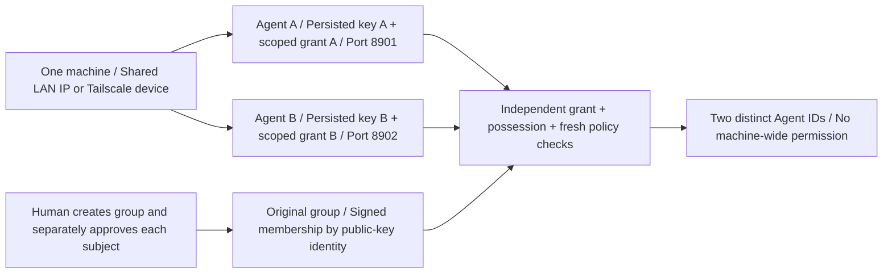
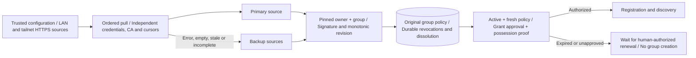
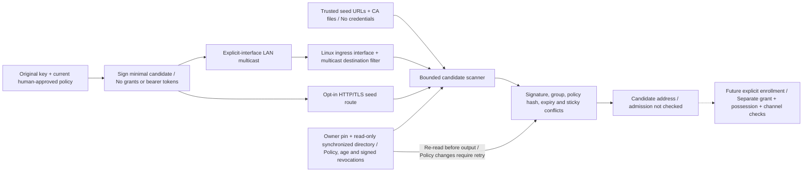
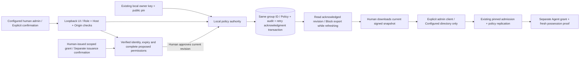
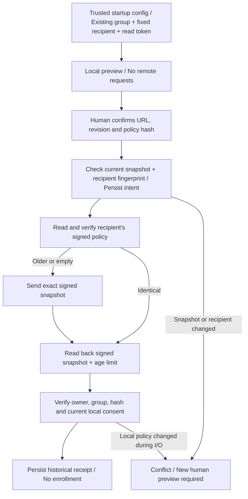
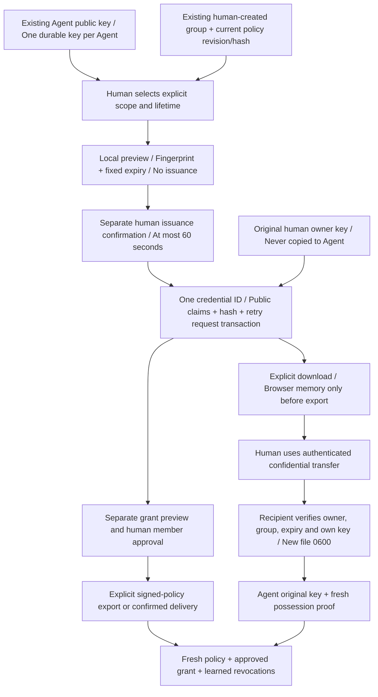
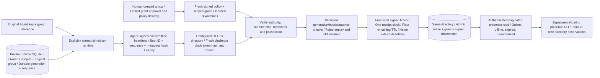
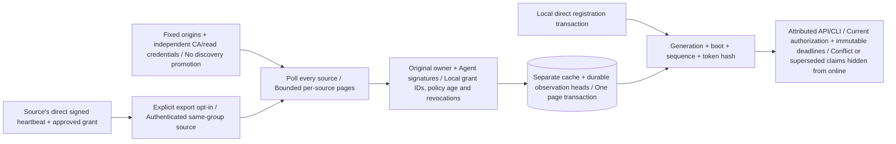
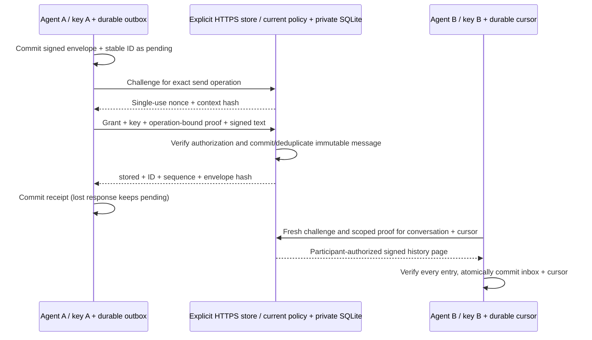

# ADR 001: Authorized, self-organizing agent groups

Status: accepted direction; implementation staged. This document supersedes
"destroy the group when its last online member disappears". Existing registry
mode remains usable. Mesh mode is not implemented on the network yet.

The [README architecture diagrams](../README.md#architecture) show the current
components, explicit human policy handoff and planned integrated peer network.
Solid arrows describe implemented calls; dashed arrows describe future
integration. Discovery, authorization and product adapters remain distinct.

## Product contract

A human owns a trust domain and explicitly creates each logical group.
Authorized agents discover and resume those groups across LAN,
Tailscale, or configured seed links. Machines need not belong to Tailscale on a
LAN. Discovery grants no membership or execution authority. Agent products are
executors behind bridges, not trusted permission engines.

A group survives member downtime and restart. An empty online set means sleep,
not destruction. Membership credentials, identity and conversation history are
persistent; presence is temporary. Explicit authorized dissolution permanently
closes that group instance. A new instance has a new ID, even with the same name.

## Identities and durable data

| Object | Stable identity | Persistence |
|---|---|---|
| Trust domain | Owner public key / domain ID | Human-controlled trust configuration |
| Group instance | Random unique group ID bound to signed policy | Member nodes and approved storage |
| Agent | Independent public key / agent ID | Local private key, grants and group references |
| Human | Independent authenticated user principal | Trusted UI account/session provider |
| Runtime incarnation | Fresh boot identifier | Presence and diagnostics only |
| Message/task | Unique ID and origin | Relevant authorized storage/executor |

Human principals and agents are distinct. A restarted process retains the agent
identity and group instance, but starts a fresh runtime incarnation. IP addresses,
DNS names and display names are locators, not identity. Private keys never gossip.

Multiple Agents on one machine are independent subjects, including when they
share an IP, hostname, Tailscale device or display name. Each uses its own durable
key and scoped grants, with independent human approval, removal and revocation.
Separate listeners use different ports; an explicitly configured gateway can
route multiple identities through one origin. Neither admission nor candidate
deduplication uses the host as a uniqueness constraint. Reusing the same key
represents the same Agent, not another member; conflicting locators for that
subject remain subject to clone/conflict handling. v0.23 adds per-directory runtime
ordering; distributed fencing and malicious cloned-key recovery remain future work.

## Components

1. Discovery providers: opt-in IPv4 multicast and explicit HTTP/TLS seeds produce
   signed candidates. mDNS/DNS-SD, tailnet enumeration and mesh enrollment remain planned.
2. Group engine: verified membership claims, anti-entropy synchronization,
   local reachability observations, persistent checkpoints.
3. Authorization verifier: signed policies and scoped credentials, proof of
   private-key possession, expiry and revocation checks.
4. Task adapter: authenticated peer calls, durable idempotency and results.
5. Human gateway: trusted Web UI, human sessions, chat routing and approvals.
6. Conversation store: initially one designated node per group.

Discovery announcements contain protocol version, group ID, policy fingerprint
and an entry endpoint; do not expose detailed capabilities or private history
before authentication. Candidate addresses must be validated independently and
must never receive credentials before verified identity/channel setup.

LAN discovery is limited to interfaces selected by the user; guest Wi-Fi
isolation and blocked multicast require seeds. Tailnet probing uses only visible,
allowed candidate devices, with bounded concurrency and explicit ports. Merge
candidates from providers by verified identity, not address.

## Group state transitions

| Trigger | Result |
|---|---|
| Authorized member finds an existing group | Verify identity, policy and grant; synchronize |
| Authorized member has saved group but finds no peer | Resume same group provisionally; keep searching |
| Agent has no saved or authorized group | Remain unbound; show a join/create request to a human |
| Authorized human confirms creation | Create a new signed group instance and issue scoped invitations |
| Member disconnects | Locally mark unreachable; preserve member qualification |
| Member restarts | Restore identity/group; authenticate; synchronize; announce fresh incarnation |
| Member explicitly leaves | Publish signed leave with monotonically newer member revision |
| Owner authorizes rejoin after leave | Issue admission according to current policy |
| All members become unreachable | No active runtime, persistent group remains recoverable |
| Administrator dissolves | Publish durable signed terminal record; never revive this group ID |

Two disconnected replicas of the SAME group reconcile later. Different group
IDs do not automatically merge. If two humans independently confirm creation of two groups,
the UI displays both; an authorized human chooses consolidation in a later phase.
A network timeout never proves that a group does not exist.

## Replication and conflict rules

Replicate verified member claims, group policy and signed terminal records.
A member authors its own join/heartbeat/leave claims. Other members can report
reachability observations but cannot impersonate the subject or revoke it.
Higher valid revisions supersede lower revisions; contradictory claims at an
equal revision are equivocation and require explicit handling, not last-arrival
wins. Persist revision counters across restart. Detect cloned identity instances;
production fencing/credential rotation is required before accepting conflicting
writers. A group-level terminal dissolution record dominates membership updates.

The simulator models these ordering rules after verification. Production needs
standard cryptographic encoding, domain separation, policy/credential validation,
replay bounds and an admission check. A Python caller-supplied sender string is
NOT authentication. Gossip/SWIM alone is NOT the permission layer.

## Authorization and revocation

Preconfigure the owner's public key. Credentials bind domain, group scope,
subject key, role, allowed skills, expiry and issuer. Default members cannot
issue grants. New-group creation belongs to authorized HUMAN principals, not agent runtime
policy. Membership and recovery permissions are separate from creation.
Each task is authorized by the receiving bridge regardless of model output.

During partition, immediate global revocation is unavailable. Ordinary grants
have bounded validity; sensitive actions require sufficiently fresh authorization
confirmation and fail closed when unavailable. Revocation and dissolution must
remain durable longer than stale credentials can be accepted. Offline nodes may
not yet know dissolution; sensitive work cannot rely only on their stale copy.
Authority key recovery/rotation and credential renewal UX remain open decisions.

### Implemented signed-age gate and configured-source failover (v0.18)

In verified policy mode, active authorization ends at signed `issued_at` plus a
local maximum age (default 300 seconds). The bound persists in SQLite and cannot
be increased by restarting; it can be tightened. Receiving the same snapshot,
restarting or changing sources never changes that deadline. Registration leases
are capped by both policy and credential expiry. Registration/discovery fail
closed on stale policies or policy timestamps more than 30 seconds in the future.
Trusted synchronized wall clocks are required; this is not a secure-clock design.

Only the existing human-controlled authority can sign a newer policy revision.
Receivers and source relays possess no owner private key and cannot automatically
refresh authorization. Missing sources or expired policy preserve the original
group, identity and tombstones while waiting; they never create a replacement.

Every poll starts with the primary and stops after the first source supplies a
usable policy and a completed bounded revocation scan. A source's cursor cannot
skip another source's records. Valid partial records persist through failover.
Existing owner/group pins, rollback/conflict rejection and terminal dissolution
apply equally to all sources. Status reports source indexes, not credentials or
transport exception contents. No credentials are obtained from peer discovery.

Ordered failover is not quorum consensus, anti-entropy across all sources or
replay-resistant online authority attestation. A still-fresh primary may hide a
newer backup policy; unseen revocations remain possible within the age bound.
LAN and Tailscale use the same hostname-verified TLS transport. Cross-machine
trials and integrated mesh discovery remain future work; tests use synthetic identities.

### Implemented candidate discovery (v0.19)

An existing approved simulation key signs short-lived minimal announcements.
The verified directory's optional public seed route and opt-in multicast publisher
use its current policy, persisted age bound and learned revocations. Missing,
expired, dissolved or unapproved state suppresses publication; startup never
creates a group/key or loads the owner private key. UDP is unsolicited, one
packet per five seconds on one selected IPv4 interface, multicast TTL 1.

The scanner contacts only configured seed origins, sends no Authorization/Cookie
headers and never follows candidate URLs or redirects. HTTPS chain/hostname trust
is independent of the announcement signature. Provider results merge by verified
subject, not locator. Any second distinct locator marks that key as conflicted
for the entire scan, including after expiry or dropping a third locator. Provider
labels belong only to the retained announcement version. Duplicate delivery
cannot refresh signed expiry. Announcements are
at most 30 seconds old; more than five seconds of future issue time is rejected.

A local-policy candidate is not proof of an unexpired grant, live endpoint/channel
ownership or execution rights. The CLI requires an existing synchronized directory
database and reads it without opening Registry or resetting leases. It enforces
the owner/group pin, policy mode, persisted age bound and signed learned revocations,
then re-reads state before output. Newly learned revocations/tighter bounds apply;
a changed policy aborts the scan for retry. Later updates require another scan.
LAN reception fails closed without Linux IP_PKTINFO and a local primary IPv4
address. Ingress interface/destination checks precede the 128-attempts/second
verification limit; that limit pauses processing without ending the scan early.
Same-interface flooding can still exhaust receive queues. No discovery result automatically
changes membership, invokes registration, learns owner trust or becomes a policy
source. The signed policy/grant/proof path remains mandatory for admission.
Cloned-key fencing, mDNS, tailnet enumeration, actual cross-machine trials and
the integrated group runtime remain future work. See [discovery](discovery.md).

### Implemented human signing gateway (v0.20)

The trusted human's loopback UI can optionally load an existing owner private
key, a separately pinned public key and one configured admin principal. POSIX
file checks reject symlinks, other owners and group/world access. The authority
and human principal persist in SQLite; restart cannot silently replace them or
disable signing. No startup key/group generation or automatic policy renewal occurs.
Directories continue to hold only the owner public key and signed public policy.

Explicit signed creation commits one empty policy and local group with the same
ID. Human membership and simulated Echo actors convey no cryptographic Agent
membership. Previews are read-only. Approval, removal and renewal use expected
revision checks and persistent request deduplication. Raw grants are not stored;
retry records contain a hash. Signatures, policy changes, retired grant IDs and
audit commit together. Removing an identity retires its current IDs locally;
reapproval requires a newly issued grant. Confirmed dissolution atomically commits
local read-only history state and signed terminal policy. No failed signature can
partially change either side. Existing local-only groups are never converted.

Exports require the configured admin and group creator. Mutations and management
refreshes invalidate the previous cached export. Download-ready feedback and
exports stay blocked until a read reaches the acknowledged revision. Failed
post-commit reads retry without repeating the mutation; older overlapping reads
cannot overwrite the newest refresh. Dissolution also waits for its terminal
snapshot before enabling export. Signing and export alone do not contact
directories. A human explicitly applies the export or confirms delivery to a
configured recipient, which can use existing LAN/Tailscale replication. Approval
has no remote effect until delivery, and never registers an Agent or proves live
possession. Receivers still apply expiry and learned revocations. Credential
issuance is a separate human confirmation in v0.22; private-file installation
validates the recipient identity and transfer remains manual. Owner rotation/recovery, hardware keys, remote human sessions and candidate-to-runtime
trust handoff remain future work. Local audit/backups are not tamper-proof. See
[human policy signing](human-policy.md) for recovery and retry limits.

### Explicit policy delivery (v0.21)

Recipient configuration is optional, fixed at startup and bound to an existing
human-created signed group. Discovery cannot add recipients. Opening the UI,
signing, previewing and restarting never contact them. Delivery does not sign,
renew, issue grants or register Agents. TLS, pinned owner/group verification,
direct connections and redirect rejection apply to LAN and Tailscale recipients.

The SQLite intent and original receipt survive restart. An unknown attempt can
be retried explicitly; an identical remote snapshot is read back without another
POST. Completed identical requests return their original timestamped receipt.
Receipts report the receiver's age bound and conservatively evaluated state at
that time, not continuing freshness, live membership or possession. Expired
snapshots can be copied without renewal. Higher, conflicting or terminal remote
policies are not overwritten.

Network I/O does not hold the local policy database lock. Local changes during
delivery invalidate the final acknowledgment, though the older copy may already
have arrived; a human must preview and deliver the latest revision. There is no
distributed atomic update, background retry or automatic revocation broadcast.
See [policy delivery](policy-delivery.md).

### Human credential issuance and recipient installation (v0.22)

Issuance neither creates an identity/group nor changes policy membership or its
revision. Consent binds the canonical public key, complete grant scope, lifetime,
owner/group, policy hash/revision and fixed issued-at time. A changed policy or
expired preview requires new human confirmation for a new issuance. Separate
Agents on one host use different keys and credentials.

SQLite stores public claims and the signed-token hash, not complete grants.
An explicit identical retry deterministically reconstructs the same Ed25519 JWS
with its original credential ID and expiry. Startup/history reads never do so.
Expired, locally retired and dissolved-group retrieval fails closed. Issuance
history is local plaintext metadata; the owner signer can reconstruct valid
credentials, and database rollback/tampering protection remains unimplemented.

The installer reads a bounded token from stdin and validates it against the
recipient's existing key before exclusive mode-0600 creation. It does not replace
keys/files, contact peers, approve membership or register anything. Browser
Downloads copies have OS-controlled permissions and must be handled separately.
Transfer is operator-controlled; automatic confidential provisioning, candidate-to-runtime
trust handoff and key rotation/recovery remain future work. See
[credential issuance](credential-issuance.md).

### Implemented simulation runtime and signed observations (v0.23)

The runtime starts no product adapter or executor. Construction loads existing
key/grant/group, checks local signed credential scope and binds a private state
file; the explicit run loop contacts only its configured directory. No group,
identity, grant or policy is automatically generated or renewed. POSIX state
ownership/permissions and a cooperative exclusive file lock apply per Agent.
Distinct keys/state files let multiple processes share one host/IP/Tailscale
device without merging subjects.

Each process commits a higher generation before sending and uses a fresh boot
ID. Heartbeat sequence commits precede I/O. The directory atomically saves signed
observations with registration/grant leases, bounded by presence, credential and
policy deadlines. Signed timestamps preserve fractional seconds and accept
existing integer values. Ten seconds is the minimum requested TTL and remaining
grant/policy validity; transport may reduce the signed heartbeat's acknowledged
lease to 1–9 whole seconds. One receipt-time snapshot determines its rounded-down
TTL and effective expiry without extending any deadline; less than one full
second of heartbeat validity is rejected. Lower generation, replayed sequence and same-generation
different-boot requests cannot replace the incumbent. After opt-in, that identity
cannot downgrade to legacy registration on the directory. Other legacy identities
retain their existing behavior.

Offline is signed observation state, not removal. Crash/partition ages out the
lease; a lost response is followed by a higher-sequence fresh heartbeat, not a
permission renewal. Stop during challenge blocks the later online request and
graceful shutdown attempts signed offline. Directory restart preserves ordering,
policy and revocation history while invalidating old live leases. Reads and
discovery recheck policy/grant/heartbeat expiry and revocation, so saved signatures
alone cannot restore online status or authorization.

The CLI verifies Agent signature, scope, metadata and deadline bounds, then reports
the configured receiver's observations. These are neither receiver-signed
attestations nor global reachability/executor health. Presence is not part of
policy/revocation replication, and the local human chat UI retains separate Echo
participants. State backup rollback, malicious holders of a cloned key, distributed
fencing and physical-network validation remain open; authenticated UI monitoring
is added separately below.
See [runtime operations](agent-runtime.md).

### Authenticated runtime observations on the human gateway (v0.24)

```mermaid
flowchart LR
  CONFIG["Existing human-created signed group / Fixed directory ID, origin and CA"] --> SELECT["Signing admin + group creator / Explicit read"]
  SELECT --> CAPTURE["Capture original owner/group + local policy + source config"]
  CAPTURE --> READ["GET source policy / One signed presence page / GET policy again"]
  READ --> VERIFY["Agent signatures, metadata, cursor and deadlines / Source policy matches local snapshot"]
  VERIFY --> GUARD["Recheck local policy/config and access / Discard changed reads"]
  GUARD --> PAGE["Source/time-scoped online, offline, expired, unauthorized or unconfirmed"]
  PAGE --> BROWSER["Clear on refresh/error/context changes / Monotonic expiry / No late-response reuse"]
```

This is a read-only integration at the already trusted loopback gateway. It
reuses explicit policy-recipient configuration without adding discovery sources
or performing delivery. Network I/O holds no local database lock. Online needs
a fresh source policy identical to the local signed snapshot; a newer, older or
conflicting source snapshot stays diagnostic and is never adopted automatically.
Local/source policy or configured-source changes during I/O discard the page.

Observations are not copied into another registry or persisted in the UI database.
The browser receives validated display fields, not full grants or source read
credentials. Same-host keys remain distinct. It ages displayed leases without
polling peers and invalidates data on source/group/policy changes, close/logout,
failed refresh and superseding requests. A clock rollback cannot revive an
expired cached display. The receiver's grant/revocation decision remains its
authenticated observation; no independent grant proof or global/executor health
attestation is implied. See [runtime monitoring](runtime-monitoring.md).

### Configured one-hop presence observations (v0.25)

Export is a new explicit opt-in because replicas receive full scoped grants for
independent verification. Existing presence reads and the human monitor retain
their direct scope and omit grants. The receiver holds no owner private key and
imports neither membership nor registration. Cached copies are never exported
onward. Multiple Agent keys remain distinct even with identical host metadata.

Each imported page validates Agent/owner signatures and scope before committing
cache and ordering changes together. Every source is polled, with independent
bounded cursors; partial valid pages persist through later failure. I/O holds no
directory lock and stop prevents late applies. Local authorization and deadlines
cap data at import; repeat claims can only shorten the stored expiry and cannot
rearm negative state. Reads recheck current local authorization and revocations.

Observation heads persist after source removal/reconfiguration and receiver
restart, suppressing old generations/sequences when a newer claim expires or
becomes unavailable. Equal-generation boot conflicts or same-sequence token
contradictions stay conflicted until a higher generation arrives. These are
merged-view rules, not distributed admission fencing: local runtime registration
keeps its existing independent per-directory verifier. Backups now include copied
grants and must preserve the private cache/head transaction boundary. Trusted
clocks/local database operators and rollback limits remain unchanged. See
[peer presence](peer-presence.md).

### Signed messages at a designated store (v0.26, unreleased)

Synthetic Agent keys explicitly select one existing group and trusted history
origin/audience/CA. The opt-in admission service checks current signed policy,
scoped grants, revocations and an operation-bound fresh possession proof for every
send/read. Text envelopes bind owner/group/audience, stable message/conversation
IDs, sender/recipient, optional reply reference, kind and signed creation time.
The store commits an immutable envelope before acknowledging `stored`; it does
not assert recipient delivery or execute text. Direct reads require a current
participant credential; group readers may read all retained group history.
Owners and directory bearer readers have no implicit private-history read API.
Trusted store operators hold plaintext. No E2E confidentiality is claimed.

Both-end restart preserves pending IDs, receiver deduplication and per-conversation
catch-up. Lost acknowledgments retry the original envelope at the original store;
conflicting reuse fails, not a second send. Full-page verification and inbox/cursor
commit share a transaction. Expiry/removal/dissolution block subsequent operations
without deleting retained history. A still-authorized participant can read old
private messages after the other participant leaves. The service's message
audience and client key/group/origin/audience/CA are pinned in private state.
Independent keys on the same host remain distinct; this polling transport requires
no per-Agent listener. No discovery/source promotion, group creation, enrollment,
policy signing, reply loop or task execution occurs.

This is a designated-store network path, separate from human-principal Echo chat,
MCP tasks and presence. Human UI routing, multi-store replication/failover, push,
E2E encryption, retention/cancellation UX and physical LAN/tailnet trials remain
future work. See [network messaging](network-messages.md) for deployment and limits.

## Human interaction

The human UI shows groups, verified members, local reachability, capabilities,
tasks and pending approvals. Do not display inferred reachability as global fact.
Initially use one trusted human gateway; accepting an arbitrary member's Web UI
as an administrator entry is not safe. Later alternate entry points need explicit
trust registration and signed human authorization semantics.

Group chat supports explicit mentions. Ordinary messages go to a designated
moderator agent, not every agent. Agent messages do not trigger automatic peer
replies by default. Explicit discussion rounds bound participants and depth.
Messages include conversation ID, message ID, sender principal, reply reference,
message kind and provenance. Chat, task submission and approval are distinct.

Private chat ACLs include only the human and target agent. Initial trusted
storage can enforce those ACLs; confidentiality from storage or relay operators
requires end-to-end encryption before making that promise. Do not advertise E2E
privacy based only on UI filtering. No group administrator implicit read access.

Conversation history uses a designated store initially. Its downtime does not
stop discovery or peer tasks, but history/delivery can be unavailable. A UI outbox
is a target requirement for the browser. v0.26 implements a separate Agent CLI
outbox with committed/pending state; browser integration remains future work. No false "delivered" acknowledgment.
Group dissolution does not imply irreversible deletion of history; retention is
an explicit separate human action.

## Tasks

The caller chooses an executor. Deduplication lives on that executor and must
be durable before real side effects. Do not automatically migrate an uncertain
task to another executor. Model permissions and network permissions are both
necessary; network membership never grants filesystem or secret access.

## Implementation stages

- v0.4: central directory, Echo bridges and MCP tools (existing).
- v0.5: design contract and deterministic mesh state simulator.
- v0.6–v0.10: local human UI, roles, explicit groups and lifecycle.
- v0.11: optional Agent signature/grant primitives, not integrated with mesh.
- v0.12: in-process verified directory admission and durable signed revocation;
  existing network services remain unchanged.
- v0.13: separate loopback HTTP admission and signed registration client;
  no cross-machine mesh or UI policy integration.
- v0.14: direct TLS admission transport with client CA/hostname validation;
  real LAN/tailnet trials and signed group-policy integration remain pending.
- v0.15: durable signed group policy, explicitly approved credential IDs,
  rollback/conflict rejection and terminal dissolution in opt-in verified admission.
- v0.16: configured-peer full signed-policy pull over HTTP/TLS, periodic
  synchronization, manual CLI and read-protected status. No automatic mesh discovery.
- v0.17: paginated signed credential-revocation replication, bounded scans,
  restart-safe learned revocations and source generation handling.
- v0.18: signed-age authorization gate, persisted tighter bounds,
  lease expiry caps and ordered configured-source failover with separate cursors.
- v0.19: existing-identity candidate beacons over explicit-interface
  multicast and configured HTTP/TLS seeds; no automatic enrollment.
- v0.20: opt-in local human policy signing and export, grant preview/
  approval, removal, manual renewal and terminal dissolution with transactional audit.
- v0.21: explicit configured-recipient delivery, signed readback,
  historical age receipts and restart-safe human retry.
- v0.22: separate human credential issuance/download and stable
  recovery, recipient identity validation and exclusive private-file installation.
- v0.23: explicit simulation runtime, durable instance ordering,
  signed heartbeat leases and authenticated paginated presence observations.
- v0.24: authenticated, explicitly read runtime monitoring on the
  human gateway, with source/time attribution and signature/policy/expiry guards.
- v0.25: explicit one-hop presence exports/pulls, independent grant
  checks, attributed cache and durable merged-view ordering.
- v0.26 (unreleased): signed group/direct text at a configured trusted store,
  scoped operation proofs, durable outbox/deduplication and catch-up cursors.
- Next: durable task execution and candidate-to-runtime trust handoff.
- Next: integrated mesh transport with cryptographic admission.
- Then: validated agent adapters and real LAN/tailnet trials.

Do not replace working registry mode until mesh fault and authorization tests pass.

## Acceptance scenarios

Restart retains identity and original group. Creator departure does not dissolve.
Partition recovery converges membership without granting extra permissions.
Foreign-domain/group claims and unauthorized admission are rejected. Stale leave
or join messages cannot roll state back. All-node downtime is recoverable from
saved state. Authorized dissolution is terminal once learned. Chat does not loop;
private history is isolated; uncertain tasks are not silently executed twice.

## ADR amendment: human-confirmed group creation

New logical groups MUST be created by a human action with a concrete name,
new unique ID, trust policy, selected initial members and history policy.
Agent runtime cannot silently invent a group ID, clone a group from a display
name, or expand membership when discovery times out. An agent can suggest
creation/join and display candidates; an authorized human makes the decision.

Previously authorized agents may automatically rejoin or resume a saved group
instance, using the SAME group ID and still-valid qualification. That is recovery,
not new creation. Show "restoring original group" or "waiting for peers" in the
human interface. No timeout may turn restoration into new-group creation.
If credential renewal, policy freshness or dissolution status cannot be established,
apply the authorization rules above; do not silently bypass them.

The current chat demo requires human creation for fresh groups; existing legacy
group history is preserved on upgrade. The simulator receives its policy from
the test harness. Runtime network group formation remains future work.
v0.9 implements a local human group-creation form and database membership checks.
v0.20 adds optional human policy signing/export and v0.21 adds explicit delivery;
runtime mesh integration remains
future work. The old automatic-creation proposal is superseded.

Current implementation boundaries are tracked in [status.md](status.md); signed group
policy issuance from the human UI is opt-in with explicit export or confirmed delivery;
full lifecycle runtime replication remains future work.
v0.15 implements durable owner-signed group snapshots and opt-in enforcement
in verified admission, including member removal and terminal dissolution.
v0.16 adds configured-peer policy replication, including removals and dissolution.
v0.17 also replicates signed credential revocations. v0.25 adds a separate
one-hop presence-observation cache. v0.26 adds designated-store signed messages;
durable tasks, multi-store messages and multi-hop presence remain unimplemented.
The mesh simulator remains separate. The UI can now sign/export these snapshots
with an existing local authority; runtime enrollment remains separate.
v0.18 bounds active-policy age and adds source failover; it does not connect those
independent paths or grant membership through discovery.
